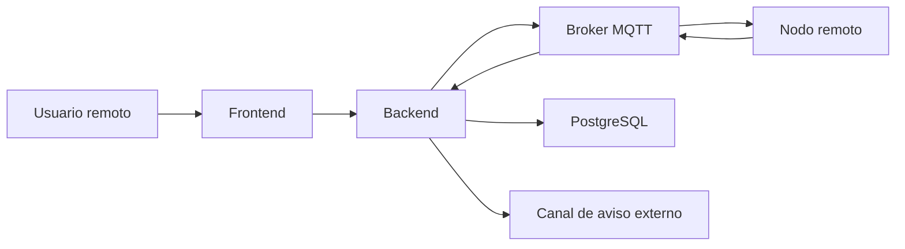

# Modelo de amenazas de RuedAlerta

> **Alcance pendiente de reevaluación:** después de este modelo se acordaron SMS directo con módem y SIM, lista de contactos en el nodo, correos del backend, fotos privadas en almacenamiento externo y eliminación coordinada de cuentas. Estas superficies todavía no se han analizado de forma completa aquí; los riesgos, límites y controles de la versión original no constituyen una evaluación actualizada. Véanse las [decisiones de datos](decisiones-diseno-datos.md).

**Estado:** análisis inicial de diseño, no auditoría de producción ni prueba de vulnerabilidades. El usuario confirmó que quien despliegue el sistema debe poder exponerlo a internet. Las prioridades son provisionales y dependen de las decisiones de conectividad, autenticación, despliegue y datos aún pendientes.

## Executive summary

Los riesgos previstos más relevantes son el acceso cruzado a ubicaciones y contactos, la suplantación de nodos o alertas y la interrupción o manipulación de avisos. La arquitectura incluye componentes todavía no implementados, por lo que los escenarios siguientes son **amenazas posibles**, no vulnerabilidades comprobadas. El prototipo no debe tratarse como un servicio de emergencia fiable sin validación adicional.

## Scope and assumptions

- **En alcance:** frontend, futuro backend, broker, nodo y almacenamiento, sus límites de confianza y configuración de desarrollo y despliegue. Referencias: [arquitectura](../ARCHITECTURE.md), [requisitos](requisitos-ieee830.md) y [política de seguridad](../SECURITY.md).
- **Fuera de alcance:** auditoría interna de proveedores, infraestructura de ECU 911 y evaluación completa de seguridad física de vehículos. Se considera el efecto de un nodo robado o manipulado como supuesto, no como prueba realizada.
- **Implementación observada:** el frontend es una plantilla Next.js (`apps/frontend/src/app/page.tsx`, `apps/frontend/package.json`); las carpetas `apps/backend/` y `apps/broker/` no contienen una implementación de aplicación; el firmware está pendiente. La arquitectura de MQTT, base de datos y alertas es propuesta, no evidencia de controles reales.
- **Supuestos:** una instalación puede atender a varios usuarios y nodos; nodos y usuarios podrán acceder remotamente a una instalación expuesta. Se tratarán coordenadas y contactos como datos sensibles. La exposición exacta de cada componente, identidad de usuarios y dispositivos, autorización, configuración de TLS, canales de aviso y proveedores aún no están definidos.
- **Preguntas abiertas:** ¿qué componentes serán públicos y cuáles privados?, ¿cómo se aprovisionan y revocan credenciales?, ¿se permiten nodos compartidos?, ¿qué datos y cuánto tiempo se conservan?, ¿cómo se verificará la entrega de avisos? Estas respuestas pueden cambiar la prioridad.

## System model

### Primary components

El frontend previsto presenta información; el backend previsto controla permisos, procesa eventos y solicita persistencia; Mosquitto enruta mensajes MQTT; PostgreSQL almacenará datos; los nodos generan eventos y respuestas de ubicación. Los proveedores de avisos y ECU 911 son externos y aún no están integrados. Evidencia de diseño: [arquitectura global](../ARCHITECTURE.md). La compilación y dependencias del frontend son superficies separadas de desarrollo, no puntos de entrada del usuario final (`apps/frontend/package.json`, `apps/frontend/pnpm-lock.yaml`).

### Data flows and trust boundaries

- **Usuario / internet → frontend y API:** credenciales, solicitudes y datos de ubicación; protocolo de API y controles de identidad, autorización, cifrado, validación y límites: pendientes. No se supone que la base de datos o administración sean públicas.
- **Nodo / red → broker:** eventos, comandos y posiblemente ubicación por MQTT; identidad del nodo, temas, control de acceso, cifrado, validación y límites: pendientes.
- **Broker → backend:** mensajes y metadatos; validación del origen y contenido, correlación y deduplicación: pendientes.
- **Backend → PostgreSQL:** cuentas, vínculos, contactos, eventos y ubicación; autenticación, permisos, cifrado y retención: pendientes.
- **Backend → canal externo:** alerta y datos de contacto/ubicación; canal, minimización de datos, autenticación, resultado y reintentos: pendientes.
- **Desarrollo → artefactos desplegados:** código, dependencias y configuración; revisión de cambios, procedencia y gestión de secretos: pendientes. No se presupone un CI implementado.

#### Diagram

Las flechas representan flujos previstos; las conexiones efectivas, protocolos y controles están por definir.

## Assets and security objectives

| Activo | Por qué importa | Objetivo |
|---|---|---|
| Coordenadas e historial | Pueden revelar movimientos de una persona. | Confidencialidad e integridad. |
| Cuentas, credenciales y vínculos nodo-usuario | Dan acceso a datos y control de nodos. | Confidencialidad e integridad. |
| Eventos y configuración de contactos | Su alteración puede generar alarmas falsas o impedir avisos. | Integridad y disponibilidad. |
| Broker, backend, base de datos y nodo | Una interrupción puede impedir comunicación y notificaciones. | Disponibilidad e integridad. |
| Código, dependencias y configuración | Compromisos de suministro pueden afectar instalaciones. | Integridad y confidencialidad de secretos. |

## Attacker model

### Capabilities

Como hipótesis de diseño, considerar un atacante remoto que pueda alcanzar interfaces que el administrador exponga, enviar entradas arbitrarias o intentar credenciales propias o robadas; también considerar un usuario autenticado que intente acceder a nodos ajenos. La manipulación o robo físico de un nodo se contempla de forma condicional.

### Non-capabilities

No se presupone acceso administrativo al servidor, control del proveedor de notificaciones, control de ECU 911 ni acceso físico a todos los nodos. El control de red local o de un nodo específico solo se considera cuando se indica como requisito previo.

## Entry points and attack surfaces

| Superficie | Acceso previsto | Límite | Evidencia / estado |
|---|---|---|---|
| Página frontend | Navegador | Usuario → frontend | `apps/frontend/src/app/page.tsx`: plantilla inicial, no interfaz de cuentas. |
| API de aplicación | Cliente remoto, si se expone | Cliente → backend | `ARCHITECTURE.md`: prevista; rutas y autenticación no implementadas. |
| MQTT | Nodo a través de red disponible | Nodo → broker | `ARCHITECTURE.md`: previsto; listeners y ACL no implementados. |
| Base de datos | Backend u operadores autorizados | Backend / administración → datos | `ARCHITECTURE.md`: prevista; exposición y roles pendientes. |
| Configuración de despliegue | Administrador | Operador → infraestructura | `docs/casos-de-uso.md` CU-09: mecanismo pendiente. |
| Dependencias y build | Desarrollador / automatización | Fuente externa → artefacto | `apps/frontend/package.json`, `apps/frontend/pnpm-lock.yaml`; pipeline no determinado. |

## Top abuse paths

1. **Acceso cruzado:** atacante obtiene una cuenta → solicita nodo ajeno sin control efectivo de permisos → obtiene coordenadas o contactos.
2. **Suplantación de nodo:** atacante consigue o falsifica una identidad de dispositivo si el mecanismo lo permite → publica evento o responde una solicitud → altera historial o desencadena aviso falso.
3. **Captura de secretos:** credenciales se exponen en repositorio, configuración o logs → atacante las reutiliza → accede a servicios o datos.
4. **Interrupción de avisos:** atacante satura una interfaz expuesta o provoca desconexión → el flujo deja de procesar eventos → contactos no reciben aviso oportuno.
5. **Alteración del destino:** atacante accede a una cuenta sin autorización adecuada → modifica contactos → una alerta se desvía o no llega a la persona prevista.
6. **Exposición de infraestructura:** un operador publica por error la base de datos o administración sin controles adecuados → un tercero accede o altera datos.
7. **Dependencia comprometida:** código de terceros malicioso entra al proceso de desarrollo o build → afecta artefactos o secretos accesibles a ese proceso.

## Threat model table

La probabilidad indica una hipótesis para una instalación expuesta, **no frecuencia medida**. Los controles siguientes no se consideran implementados salvo que la evidencia lo indique.

| ID | Fuente y requisito previo | Acción / activos e impacto | Controles existentes y brechas | Mitigaciones recomendadas y detección | Probabilidad | Impacto | Prioridad |
|---|---|---|---|---|---|---|---|
| TM-001 | Usuario autenticado o atacante con cuenta; API expuesta. | Acceder a nodo ajeno; privacidad y seguridad personal. | Autorización por nodo prevista en `ARCHITECTURE.md`, no implementada. | Verificar permisos en backend por cada operación; pruebas de acceso cruzado; registrar rechazos sin coordenadas. | Media: depende del diseño y acceso. | Alto: exposición de ubicación. | Alta |
| TM-002 | Atacante con acceso MQTT y credencial comprometida o controles débiles. | Publicar o escuchar temas de otro nodo; integridad de alertas y ubicación. | Identidad y ACL pendientes (`ARCHITECTURE.md`). | Credenciales únicas y revocables, TLS y permisos mínimos por nodo; detectar conexiones y publicaciones rechazadas. | Media: acceso depende de exposición y credenciales. | Alto: avisos falsos o datos expuestos. | Alta |
| TM-003 | Atacante obtiene secretos de archivos, logs o artefactos. | Reutilizar credenciales; comprometer datos o servicios. | `apps/frontend/.gitignore` ignora `.env*`; no prueba ausencia de secretos ni protege otras rutas. | Gestionar y rotar secretos fuera de código, limitar permisos y revisar historial; alertar sobre credenciales expuestas y uso anómalo. | Media: depende del flujo de despliegue. | Alto: acceso amplio posible. | Alta |
| TM-004 | Atacante puede alcanzar una interfaz expuesta. | Sobrecargar broker o API; indisponibilidad y omisión de alertas. | Una instancia por componente prevista; límites y recuperación pendientes (`ARCHITECTURE.md`). | Limitar conexiones y tráfico, aislar administración, supervisar colas y salud; ensayar fallos y recuperación. | Media: depende de exposición y defensas. | Alto: avisos pueden retrasarse. | Alta |
| TM-005 | Atacante accede a una cuenta o API con permisos insuficientemente controlados. | Cambiar contactos o configuración; integridad de avisos. | Gestión de contactos prevista en `docs/casos-de-uso.md`; controles aún no definidos. | Exigir autorización por propietario, validar cambios y mantener auditoría sin datos sensibles; notificar cambios cuando se defina el canal. | Media: requiere acceso a cuenta o falla. | Alto: avisos mal dirigidos. | Alta |
| TM-006 | Instalación expone accidentalmente base de datos o administración. | Leer, borrar o modificar datos. | Modelo de despliegue y redes pendientes (`ARCHITECTURE.md`). | Mantener datos y administración privados por defecto, mínimo privilegio y credenciales únicas; supervisar accesos. | Media: depende de configuración. | Alto: afecta múltiples usuarios. | Alta |
| TM-007 | Dependencia, script o artefacto de un tercero es comprometido. | Ejecutar código en build o alterar frontend; código y secretos accesibles. | Existe `apps/frontend/pnpm-lock.yaml`; no demuestra auditoría ni integridad completa. | Revisar procedencia y cambios, fijar dependencias según política y minimizar secretos/permisos de build; monitorizar avisos aplicables. | Baja: requiere compromiso o selección maliciosa. | Alto: posible impacto amplio. | Media |

## Criticality calibration

- **Crítica:** compromiso masivo de credenciales administrativas; divulgación o modificación de datos de muchos usuarios. No se asigna automáticamente sin evidencia de exposición y controles.
- **Alta:** acceso cruzado a ubicaciones; suplantación de nodo con alertas falsas o alteradas.
- **Media:** dependencia vulnerable cuyo aprovechamiento exige condiciones no demostradas; interrupción limitada y recuperable de una función no crítica.
- **Baja:** divulgación de información pública no sensible; error visual sin acceso ni alteración de datos. Estas clasificaciones pueden cambiar con el contexto.

## Focus paths for security review

| Ruta | Motivo | Amenazas relacionadas |
|---|---|---|
| `ARCHITECTURE.md` | Registrar límites, exposición y decisiones de integración. | TM-001 a TM-006 |
| `docs/requisitos-ieee830.md` | Precisar requisitos y criterios verificables de autorización y seguridad. | TM-001 a TM-006 |
| `apps/frontend/` | Revisar interacción futura con usuarios y manejo de datos. | TM-001, TM-003, TM-005 |
| `apps/backend/` | Diseñar y revisar autorizaciones, validación y avisos cuando exista implementación. | TM-001 a TM-006 |
| `apps/broker/` | Revisar listeners, TLS e identidad y permisos por tema cuando exista configuración. | TM-002, TM-004 |
| `apps/node/` | Evaluar credenciales del dispositivo y comunicaciones cuando exista firmware. | TM-002, TM-003 |
| `apps/frontend/package.json` y `apps/frontend/pnpm-lock.yaml` | Revisar procedencia y mantenimiento de dependencias de build. | TM-007 |
| `SECURITY.md` | Definir el canal de reporte y la política de seguridad. | TM-003, TM-007 |

**Comprobación:** superficies y límites previstos incluidos; desarrollo separado del runtime; exposición remota confirmada; exposición específica, controles y pruebas reales pendientes. La ausencia de evidencia no demuestra que un control exista o falte en una instalación futura.
