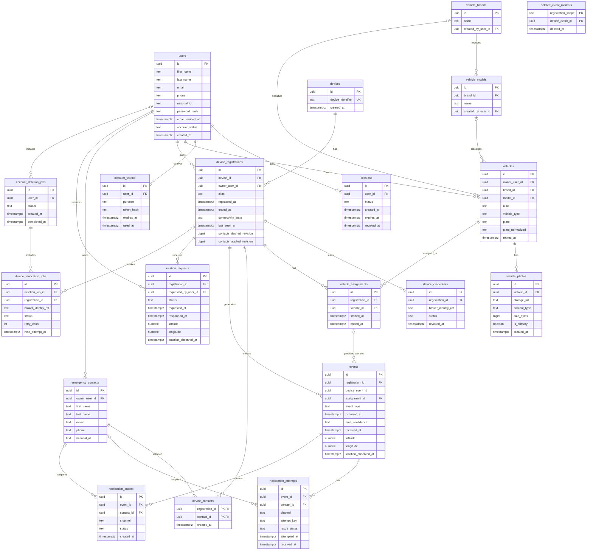

# Diagrama entidad-relación de RuedAlerta

**Estado:** diseño lógico propuesto para revisión; no representa tablas implementadas, una migración ni un esquema físico definitivo. Complementa el [diseño de base de datos](diseno-base-datos.md) y las [decisiones acordadas](decisiones-diseno-datos.md). Los nombres de tablas y columnas son propuestas. Las credenciales, la vinculación y la sincronización offline requieren contratos aún por definir.

El diagrama describe relaciones y atributos principales. No representa todas las restricciones, reglas de seguridad o estados del sistema; estas se documentan debajo. `PK` indica clave primaria y `FK` clave foránea. El signo `o` en una relación indica participación opcional, no que todos los atributos de esa entidad sean opcionales.

## Cómo interpretar las relaciones

- **Usuario y acceso:** una cuenta tiene cero o más sesiones; el registro de sesión permite gestionar la renovación y revocación. El token de acceso es JWT y existe un token de renovación, cuyo formato, duración, rotación y almacenamiento siguen pendientes. Revocar la renovación no invalida automáticamente un JWT de acceso ya emitido.
- **Vehículo y nodo:** un usuario puede tener varios de cada uno. `vehicle_assignments` conserva las asociaciones históricas; solo puede haber una asociación activa por nodo y por vehículo. Los eventos conservarán el vehículo asociado cuando ocurrieron. La barrera para eventos concurrentes durante una reasignación está pendiente.
- **Catálogo:** las marcas y modelos son compartidos en una instalación; cada modelo pertenece a una marca. Los vehículos y fotos siguen siendo privados. `created_by_user_id` es opcional en la propuesta; el tratamiento al borrar al creador todavía debe definirse.
- **Contactos:** cada contacto pertenece a un usuario y se relaciona con sus nodos mediante `device_contacts`. Cada nodo puede tener cero contactos; los datos del contacto no se conservan en intentos históricos tras su eliminación.
- **Eventos y avisos:** el UUID de evento se genera en el nodo y se mantiene en reintentos. Cada intento pertenece a un evento y conserva su contacto solo mientras exista. El correo y el SMS pueden tener destinatarios distintos si cambió la lista durante una desconexión.
- **Marca de evento eliminado:** `deleted_event_markers` se muestra sin relación física fijada porque el ámbito y las claves para sobrevivir a eliminación o reaprovisionamiento aún no están cerrados. Se conserva mientras el evento pueda reenviarse y solo podrá retirarse cuando haya evidencia de que ya no puede aceptarse.
- **Ubicación:** las solicitudes y respuestas se guardan por separado de los eventos y se conservan hasta que el usuario decida eliminarlas; los detalles de respuesta tardía y eliminación de cuenta quedan pendientes.
- **Eliminación de cuenta:** los trabajos de borrado y revocación son una propuesta lógica para que la eliminación permanezca pendiente hasta confirmar la revocación MQTT. Las referencias opcionales y la limpieza deben diseñarse sin conservar datos personales innecesarios.

## Reglas que no expresa Mermaid

1. Usuario: nombres, apellidos, correo y teléfono obligatorios; cédula opcional de 10 dígitos. Correo, teléfono y cédula presente son únicos por instalación. El teléfono incluye `+` y código de país; el correo se compara sin distinguir mayúsculas y sin espacios en los extremos.
2. Contacto: nombres, apellidos, correo y teléfono obligatorios; cédula opcional de 10 dígitos. Correo, teléfono y cédula presente no se repiten dentro de la lista del mismo propietario. El teléfono usa el mismo formato internacional. Las reglas de comparación del correo del contacto y validación de cédulas siguen pendientes.
3. Vehículo: marca y modelo son opcionales, pero si existe modelo debe corresponder a la marca. La placa es opcional y única entre vehículos activos al compararla sin mayúsculas, espacios ni guiones; puede reutilizarse tras el retiro.
4. Fotos: cero a diez JPEG o PNG de hasta 10 MB; si hay fotos, una es principal. Al borrarla, la foto restante más antigua pasa a ser principal. Acceso solo a usuarios autenticados y autorizados como propietarios, incluso al abrir directamente la URL. Concurrencia y desempate siguen pendientes.
5. Eventos: sin TTL; el usuario puede eliminarlos y también se eliminan sus intentos de aviso. La marca mínima evita que un reenvío los recree. La unicidad concreta del UUID por nodo o registro se cerrará junto con el contrato MQTT y el reaprovisionamiento.
6. Integridad y acceso: cada operación debe comprobar que los registros relacionados pertenecen al usuario correcto. PK/FK simples por sí solas no sustituyen esta autorización. Los índices, restricciones, `NULL`, tipos definitivos y comportamiento de borrado se detallarán en la migración posterior.

## Pendientes para pasar al esquema físico

Selección de versión de PostgreSQL y ORM; detalles de UUID en ESP32; nulabilidad, tipos y restricciones definitivas; gestión de sesiones y secretos de renovación; política de formatos; protocolo de reasignación, sincronización de contactos e intentos SMS; ámbito de las marcas y su compatibilidad con eliminación de cuentas; identificadores de destinatarios anonimizados; almacenamiento privado de fotos y limpieza; manejo de accesos y borrados concurrentes. Nada de lo anterior está implementado o verificado.
